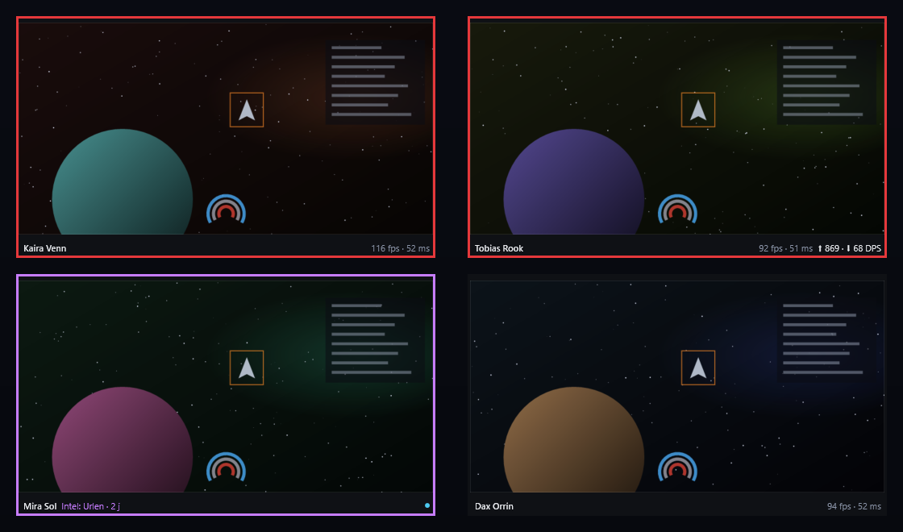
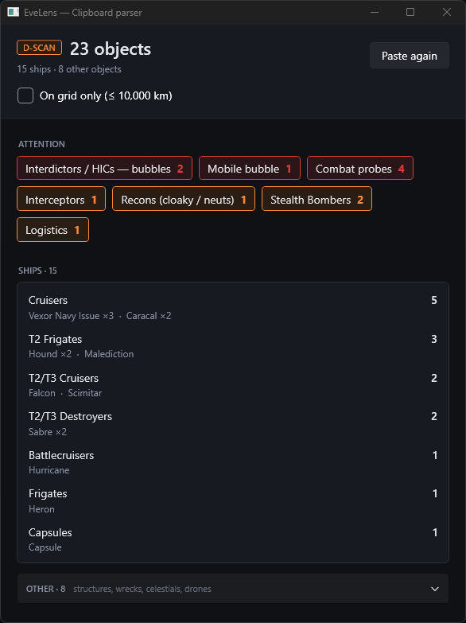
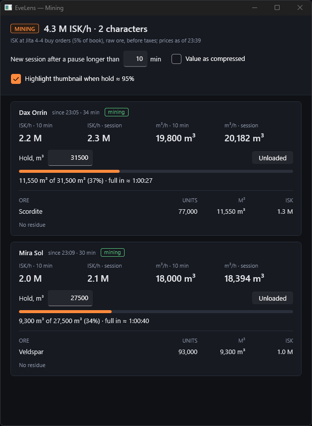
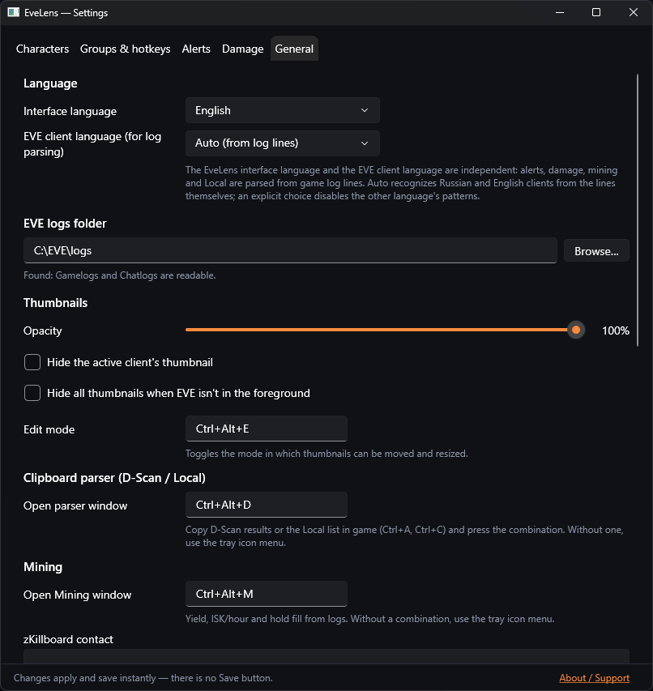
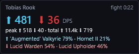
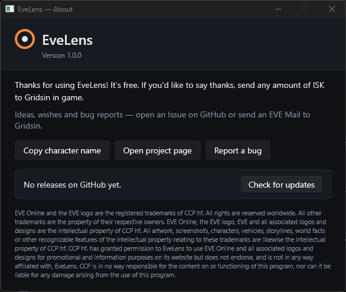

<p align="center"></p>

<p align="center">
  <a href="https://github.com/evelens-app/evelens/releases/latest"></a>
  <a href="https://github.com/evelens-app/evelens/releases"></a>
  
  
  
</p>

# GridSight

<p align="center"><b>User guide:</b> <a href="docs/guide-en.md">English</a> · <a href="docs/guide-ru.md">Русский</a> · <a href="docs/guide-de.md">Deutsch</a> · <a href="docs/guide-zh-Hans.md">中文</a><br>
<b>Инструкция на русском:</b> <a href="docs/guide-ru.md">docs/guide-ru.md</a> · <a href="FAQ.md">FAQ</a> · <a href="CHANGELOG.md">Changelog</a></p>

## What is GridSight

GridSight is a free Windows companion app for EVE Online players who run several clients at once. It shows a live preview of every client, lights up the preview when something happens to that character, and adds a few tools around it: D-Scan and Local analysis, a damage monitor, a mining panel, ping/FPS and, if you log in with ESI, a character dashboard with an advisor.

GridSight does not send input to the game, does not read client memory and does not modify game files. It reads the log files EVE writes to disk, uses the official ESI API and a few public EVE community services, and shows the result on your screen.

GridSight is free but **closed-source**: the source code is not published, and the app is distributed as a ready-to-run EXE through [GitHub Releases](https://github.com/evelens-app/evelens/releases) only.

This page describes **1.0.0-beta.2**. Items marked *(beta.2+)* are not in 1.0.0-beta.1 — see the [changelog](CHANGELOG.md).

## Video

<!-- TODO(owner): add a short video or GIF (30–60 s: thumbnails, an alert lighting up, switching clients).
     No video exists yet — do not link anything until it is recorded and uploaded.
     Suggested form: <p align="center"></p> -->

*A short demo video is coming soon.*

## Main features

<!-- TODO(owner): the screenshots below are from the previous UI theme and must be retaken for the current design.
     Keep the same file names in assets/ or update the paths here. -->

**1. Live thumbnails of every client.** One preview per EVE window, with a layout remembered per character. Drag and resize in edit mode (`Ctrl+Alt+E`), cycle through groups with your own hotkeys, click a preview to bring that client to the front. One hotkey or click switches one window.

<p align="center"></p>
<p align="center"><sub>Red frame — under attack, purple — hostile reported 2 jumps away, plus outgoing/incoming DPS, ping and FPS.</sub></p>

**2. Visual alerts and intel from game logs.** The preview of a background client gets a colored frame when the ship takes damage, is warp scrambled, the cargo hold is full, or something is said in Local. Pick your intel channels, and the character near a reported system is highlighted with the jump count. No sounds, and alerts never switch windows by themselves.

**3. Clipboard tools and combat/mining overlays.** Copy D-Scan or Local in the game and get ship classes, threats, alliances and corporations; copy items from an inventory window for an appraisal at five trade hubs *(beta.2+)*. A click-through damage monitor shows incoming and outgoing DPS, the mining panel shows ISK/hour, m³/hour and time until the hold is full, and ping/FPS can be shown for each client.

<table>
  <tr>
    <td width="50%" valign="top"><br><sub>D-Scan analysis: threats first, then ship classes.</sub></td>
    <td width="50%" valign="top"><br><sub>Mining panel: ISK/hour, m³/hour and time until the hold is full.</sub></td>
  </tr>
  <tr>
    <td width="50%" valign="top"><br><sub>Settings: interface language, logs folder, hotkeys.</sub></td>
    <td width="50%" valign="top"><br><sub>Click-through damage monitor overlay.</sub><br><br><br><sub>About: version, links, support.</sub></td>
  </tr>
</table>

With an optional ESI login you also get the **Dashboard** *(beta.2+, built in)*: wallet, assets, skills, industry, planetary industry, trading at five hubs, real profit from your trades, abyssal fits checked against your skills, and account timers in the tray.

Alerts, damage and mining read the text of game log lines. They are tuned for the **Russian** EVE client; English client support is in testing, other client languages are not parsed yet. The interface itself is available in English, Russian, German and Chinese.

## How to download and run

1. Open the [latest release](https://github.com/evelens-app/evelens/releases/latest) and download `GridSight.exe`. One file, Windows 10/11 x64, no .NET installation needed. Download it only from this page — not from Discord, forums or file shares.
2. **Check the SHA-256 before the first run.** Open PowerShell in the download folder and run:
   ```powershell
   Get-FileHash .\GridSight.exe -Algorithm SHA256
   ```
   The hash must match the SHA-256 in the release notes exactly. Step by step, and what a match does and does not prove: [DOWNLOAD_VERIFICATION.md](DOWNLOAD_VERIFICATION.md).
3. Put `GridSight.exe` in a folder of its own (for example `%LOCALAPPDATA%\Programs\GridSight\`) and double-click it. There is no installer.
4. Windows SmartScreen will probably show **"Windows protected your PC"**. If the hash matched, click **More info → Run anyway**.
5. On the first start a welcome window *(beta.2+)* shows whether EVE clients and the game log folder were found. GridSight then runs in the system tray (the icon may be hidden under the **^** arrow next to the clock): right-click it for the menu, double-click for settings. Thumbnails appear as soon as EVE clients are running in Windowed or Fixed Window mode.

**Why SmartScreen warns you.** GridSight is not code-signed: a code-signing certificate is a paid yearly subscription that this free project doesn't have. Windows shows the warning for new files without a signature or download history. It does not mean malware was found, but it does mean Windows cannot confirm who made the file — that is what the SHA-256 check is for. If your PC is managed by an organization, or Windows or your antivirus blocks the file without a "Run anyway" option, don't try to bypass it.

**Updates.** GridSight checks GitHub once a day and tells you when a new version is out. It never downloads or installs anything by itself — you replace the EXE yourself ([guide, step 9](docs/guide-en.md#step-9-updating)).

## Why you can use it without ESI

ESI login is optional. Without it, GridSight never asks for your EVE account.

| Works without any EVE login | Needs ESI login |
|---|---|
| Live thumbnails, layout, group hotkeys, click to switch | "system · ship" badge on thumbnails (**Connect ESI**, 3 read-only scopes) |
| Alerts from game logs: attack, warp scramble, cargo full, Local | Dashboard and advisor *(beta.2+)*: wallet, assets, skills, industry, PI, trading, profit, abyssal fits |
| Intel from the chat channels you choose (the character's system is taken from Local) | Account timers in the tray: PI extractors, industry slots, skill queue |
| D-Scan and Local analysis, appraisal of copied items *(beta.2+)* | Trade-history sync for the profit calculation *(beta.2+)* |
| Damage monitor, mining panel, ping/FPS | Export of abyssal fits to in-game saved fittings (command line only) |

Some no-login features still go online: Local analysis resolves the pasted pilot names through the public ESI API, Intel and appraisal download CCP's static data (about 95 MB, refreshed at most weekly), and the mining panel and appraisal fetch market prices. Thumbnails and alerts work offline.

All ESI permissions are read-only, except one optional, command-line-only permission to create saved fittings. The full list and why each is needed: [ESI_PERMISSIONS.md](ESI_PERMISSIONS.md).

## Security & Privacy

- **No GridSight servers, no telemetry, no analytics.** Nothing is sent to the author.
- Game and chat logs are read on your PC and never uploaded. Network connections go to EVE services, zKillboard, Fuzzwork and GitHub — the full list, with what is sent and when: [NETWORK_CONNECTIONS.md](NETWORK_CONNECTIONS.md).
- Login tokens are stored only on your PC, encrypted with Windows DPAPI, and sent only to CCP's servers. **Disconnect** in the Dashboard *(beta.2+)* deletes a character's token and revokes it at CCP.
- Dashboard reports and your trade history are stored on your PC **unencrypted** — what is stored and how to delete it: [PRIVACY.md](PRIVACY.md).
- How GridSight works with EVE and Windows, its limitations, and how to report a vulnerability privately: [SECURITY.md](SECURITY.md).
- ESI permissions: [ESI_PERMISSIONS.md](ESI_PERMISSIONS.md). Common questions: [FAQ.md](FAQ.md).

GridSight has not been reviewed or approved by CCP or Fenris Creations. It uses its own application registration on the EVE developer portal; a registration is not an endorsement. EVE Online is developed by Fenris Creations (formerly CCP Games); GridSight is not affiliated with Fenris Creations or CCP.

## Feedback

Bug reports and ideas are welcome:

- **GitHub Issues** with a short form: [Report a bug](https://github.com/evelens-app/evelens/issues/new?template=bug_report.yml) · [Suggest a feature](https://github.com/evelens-app/evelens/issues/new?template=feature_request.yml). The same links are in the tray menu → **Help & feedback** and in **About** *(beta.2+)*. They only open the page in your browser — nothing is sent automatically.
- **In-game mail** to **Gridsin**.

> [!WARNING]
> Issues are public. Before posting, remove anything personal from the text, logs and screenshots: character names, ESI tokens, wallet and asset information, location. Crop or blur screenshots, and paste only the relevant log lines, not whole log files.

Security problems — please report them privately, not in Issues: see [SECURITY.md](SECURITY.md).

## Support the developer

Thank you for using GridSight! It is free, and no feature is locked behind a donation.

If GridSight makes your fleet life easier, you can say thanks with any amount of ISK to the in-game character **Gridsin**. Supporters are listed below (tell Gridsin by in-game mail if you'd rather stay anonymous).

### Supporters

*Be the first!*

## About this project

GridSight is an independent project made by a fellow EVE player in spare time. Its only goal is to help capsuleers like me make the game a little easier and more comfortable.

GridSight is provided **"as is"**, without warranty of any kind. Use it at your own discretion; the author is not liable for any loss or damage arising from its use.

## Legal

EVE Online and the EVE logo are the registered trademarks of CCP hf. All rights are reserved worldwide. All other trademarks are the property of their respective owners. EVE Online, the EVE logo, EVE and all associated logos and designs are the intellectual property of CCP hf. All artwork, screenshots, characters, vehicles, storylines, world facts or other recognizable features of the intellectual property relating to these trademarks are likewise the intellectual property of CCP hf. CCP hf. has granted permission to GridSight to use EVE Online and all associated logos and designs for promotional and information purposes on its website but does not endorse, and is not in any way affiliated with, GridSight. CCP is in no way responsible for the content on or functioning of this program, nor can it be liable for any damage arising from the use of this program.

© 2014 CCP hf. All rights reserved. "EVE", "EVE Online", "CCP", and all related logos and images are trademarks or registered trademarks of CCP hf.

---

<p align="center"><b>Made by Gridsin</b> · <i>May the light of the Gate guide you, capsuleer.</i></p>
