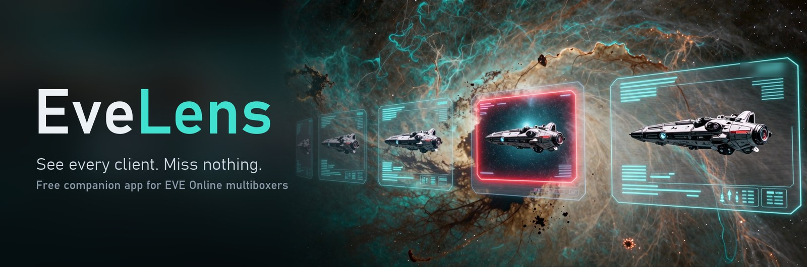

  
  
  
  
  

# EveLens

A free companion app for EVE Online multiboxers on Windows: live previews of all your clients with visual alerts, intel, scanner analysis, and a personal advisor.

EveLens never sends input to the game, never reads client memory, and never modifies game files. It only reads the logs EVE writes to disk and the official ESI API, and shows information on your screen.

## Features

**Works right away, no setup or login**
- Live thumbnails of every EVE client: per-character layout, resize and drag in edit mode (`Ctrl+Alt+E`), group hotkeys, click to switch.
- Visual alerts on the thumbnail from game logs: under attack, warp scrambled, cargo full, Local changes. No sounds.
- D-Scan and Local analysis from the clipboard: ship classes, threats, alliances and corporations.
- Damage monitor: incoming and outgoing DPS on the thumbnail and in a click-through overlay.
- Mining panel: ISK/hour, m³/hour, time until the cargo hold is full.
- Ping and FPS for each client, on thumbnails and as an overlay on the active window.

**Needs a little setup**
- Intel: pick your intel channels and get "hostile N jumps away" alerts on the right client.

**Needs EVE login (ESI)**
- Character dashboard and advisor: industry, reprocessing, planetary industry, trading suggestions.
- Abyssal fits from zKillboard checked against your skills and assets, with a Jita multibuy list and export to in-game saved fittings.
- Account timers in the tray: skills, industry jobs, PI extractors, market orders.

## Download and install

1. Download `EveLens.exe` from the [latest release](https://github.com/evelens-app/evelens/releases/latest). One file, no .NET installation required. Windows 10/11 x64.
2. Run it. EveLens is not code-signed yet, so Windows may show **"Windows protected your PC"**. Click **More info → Run anyway**. Every release links a VirusTotal scan.
3. The EveLens icon appears in the tray. Double-click it to open settings. Thumbnails show up as soon as EVE clients are running.

EveLens checks for new versions once a day and tells you when one is out. It never updates itself without you.

## FAQ

**Is it allowed by CCP?** EveLens follows the [CCP developer license](https://developers.eveonline.com/license-agreement) and the EULA: no input broadcasting, no automation, no memory reading, no client file changes. It reads the logs EVE writes to disk and the public ESI API, and only shows things on your screen.

**Is my account safe?** ESI login uses EVE SSO; EveLens never sees your password. Tokens are stored encrypted with Windows DPAPI under your user account and never leave your PC. You can revoke access any time on the [EVE third-party applications page](https://community.eveonline.com/support/third-party-applications/).

**Which EVE client languages are supported?** The interface is available in English, Russian, German and Chinese. Log-based alerts are tuned for the English and Russian clients; others are in progress.

## Thanks and support

Thank you for using EveLens! It is free, and no feature is locked behind a donation.

If EveLens makes your fleet life easier, you can say thanks with any amount of ISK to the in-game character **Gridsin**. Supporters are listed below (tell Gridsin by in-game mail if you'd rather stay anonymous).

### Supporters

*Be the first!*

## Feedback and bug reports

Ideas, wishes and bug reports are welcome in [Issues](https://github.com/evelens-app/evelens/issues), or by in-game mail to **Gridsin**.

## Legal

EVE Online and the EVE logo are the registered trademarks of CCP hf. All rights are reserved worldwide. All other trademarks are the property of their respective owners. EVE Online, the EVE logo, EVE and all associated logos and designs are the intellectual property of CCP hf. All artwork, screenshots, characters, vehicles, storylines, world facts or other recognizable features of the intellectual property relating to these trademarks are likewise the intellectual property of CCP hf. CCP hf. has granted permission to EveLens to use EVE Online and all associated logos and designs for promotional and information purposes on its website but does not endorse, and is not in any way affiliated with, EveLens. CCP is in no way responsible for the content on or functioning of this program, nor can it be liable for any damage arising from the use of this program.
